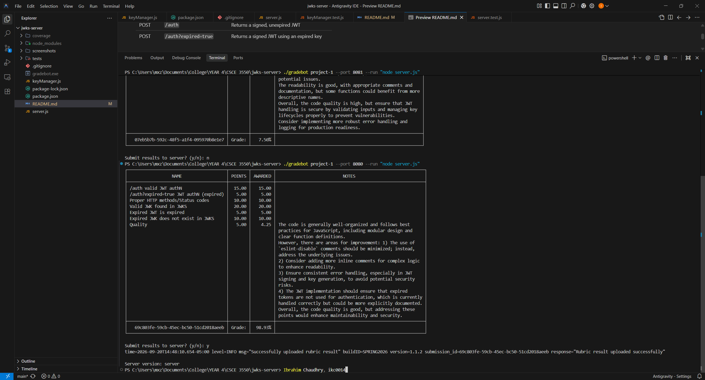
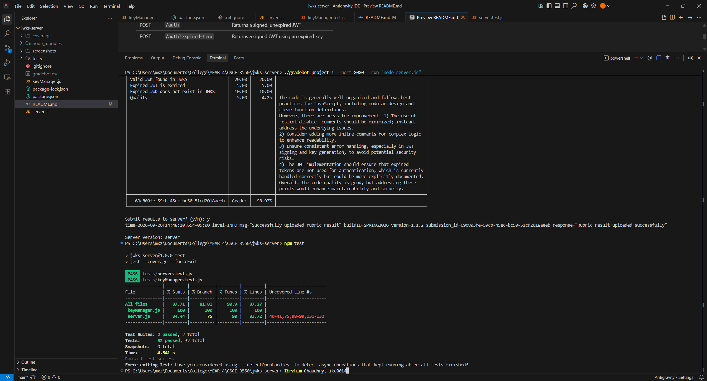
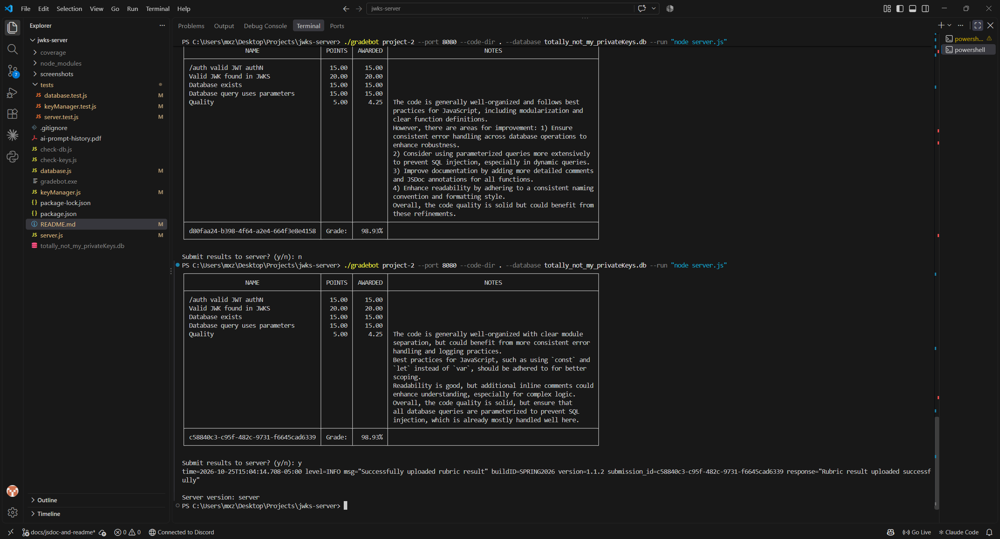
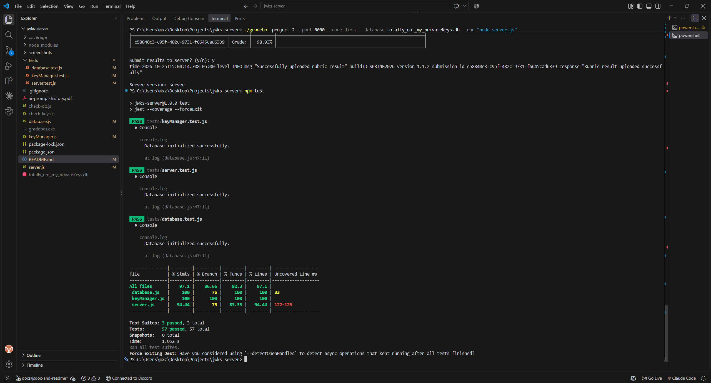

# JWKS Server

A RESTful JSON Web Key Set (JWKS) server that serves public keys for verifying JSON Web Tokens (JWTs). Built for CSCE 3550 - Foundations of Cybersecurity.

Project 1 implemented the basic JWKS server with keys held in memory. Project 2 extends it with SQLite-backed storage, so private keys persist to disk across server restarts, with every database query parameterized to prevent SQL injection.

## Features

- RSA key pair generation with unique Key IDs (`kid`) and expiry timestamps
- SQLite-backed key storage: private keys are saved to `totally_not_my_privateKeys.db` as PKCS#1 PEM strings and persist across restarts
- Parameterized SQL queries (`?` placeholders) for every database operation to prevent SQL injection
- Automatic key setup on startup, ensuring at least one valid and one expired key exist without adding rows on every restart
- JWKS endpoint serving only unexpired public keys in standard JWK format, derived from the stored private keys
- Authentication endpoint issuing signed JWTs, with optional expired JWT support via the `expired` query parameter
- Mock authentication that accepts HTTP Basic auth or a JSON body (credentials are not validated)
- Proper RESTful HTTP method enforcement (405 Method Not Allowed, 404 Not Found)

## Tech Stack

- **Runtime:** Node.js
- **Framework:** Express.js v4
- **Database:** SQLite via better-sqlite3
- **JWT Library:** jsonwebtoken
- **Testing:** Jest + Supertest

## Prerequisites

- [Node.js](https://nodejs.org/) (v22 or higher, required by better-sqlite3)
- [npm](https://www.npmjs.com/) (included with Node.js)

No separate database server is needed. SQLite is serverless, and the database file is created automatically when the server starts.

## Getting Started

### Clone the Repository

```bash
git clone https://github.com/IChaudhry892/jwks-server.git
cd jwks-server
```

### Install Dependencies

```bash
npm install
```

better-sqlite3 includes a prebuilt binary for Windows, macOS, and Linux, so no compiler is needed. If installation fails with a `node-gyp` error asking for Visual Studio, install without running build scripts instead:

```bash
npm install --ignore-scripts
```

### Run the Server

```bash
node server.js
```

The server will start on `http://localhost:8080`. On startup it creates (or opens) `totally_not_my_privateKeys.db` in the project directory.

## Database

Keys are stored in a single SQLite file, `totally_not_my_privateKeys.db`, in the project root. It is generated at runtime and excluded from Git via `.gitignore`.

The `keys` table uses the schema required by the assignment:

```sql
CREATE TABLE IF NOT EXISTS keys(
    kid INTEGER PRIMARY KEY AUTOINCREMENT,
    key BLOB NOT NULL,
    exp INTEGER NOT NULL
)
```

| Column | Description |
|--------|-------------|
| `kid`  | Key ID, auto-assigned by SQLite. Sent as a string in JWT headers and JWKs. |
| `key`  | The RSA private key, serialized as a PKCS#1 PEM string. |
| `exp`  | Expiry as a Unix timestamp in seconds. |

The public keys aren't stored. The JWKS endpoint derives each public key (`n` and `e`) from its stored private key.

## API Endpoints

| Method | Endpoint                    | Description                              |
|--------|-----------------------------|------------------------------------------|
| GET    | `/.well-known/jwks.json`    | Returns unexpired public keys in JWKS format |
| POST   | `/auth`                     | Returns a JWT signed with an unexpired key |
| POST   | `/auth?expired=true`        | Returns a JWT signed with an expired key (the `expired` parameter only needs to be present) |

The token's `exp` claim matches the expiry of the key that signed it.

## Running the Test Client Against the Server

Ensure `gradebot.exe` is in the same directory as the `server.js` file.

**Project 1:**

```bash
./gradebot project-1 --port 8080 --run "node server.js"
```

**Project 2:**

```bash
./gradebot project-2 --port 8080 --code-dir . --database totally_not_my_privateKeys.db --run "node server.js"
```

This will run the server and then run the test client against it. For Project 2, the test client also checks the database file and the code for parameterized queries.

## Running the Test Suite

Run the full test suite with coverage:

```bash
npm test
```

This will run Jest with the `--coverage` flag, displaying a coverage report in the terminal.

Tests use a temporary in-memory database (Jest sets `NODE_ENV=test`), so running them never modifies `totally_not_my_privateKeys.db`.

## Manual Testing Examples

You can interact with the server manually using tools like `curl`. Ensure the server is running (`node server.js`) before trying these commands.

> **Note for Windows Users:** If you are using PowerShell, the `curl` command is often aliased to `Invoke-WebRequest`. You may need to use `curl.exe` instead of `curl` in the commands below for them to work properly.

**1. Fetch the JWKS (Valid Keys)**

```bash
curl http://localhost:8080/.well-known/jwks.json
```
*Expected Output: A JSON object containing an array of unexpired RSA public keys.*

**2. Issue a Valid JWT**

```bash
curl -X POST http://localhost:8080/auth
```
*Expected Output: A base64-encoded JWT string.*

**3. Issue an Expired JWT**

```bash
curl -X POST "http://localhost:8080/auth?expired=true"
```
*Expected Output: A base64-encoded JWT string signed with an expired key.*

**4. Issue a JWT with a JSON Body (as the Project 2 test client does)**

```bash
curl -X POST http://localhost:8080/auth -H "Content-Type: application/json" -d '{"username": "userABC", "password": "password123"}'
```
*Expected Output: A base64-encoded JWT string. The credentials are accepted but not validated.*

> In PowerShell, escape the inner quotes: `-d '{\"username\": \"userABC\", \"password\": \"password123\"}'`

### Verifying JWTs

You can take the JWT strings output from the `/auth` endpoints and paste them into the debugger at [jwt.io](https://jwt.io/) to decode the header and payload. You'll be able to verify that the `kid` (Key ID) matches one of the keys from the JWKS endpoint and check if the `exp` (expiration time) is in the past or future.

## Project Structure

```
jwks-server/
├── server.js                       # Express server with JWKS and auth endpoints
├── keyManager.js                   # RSA key generation, startup key setup, and JWK conversion
├── database.js                     # SQLite connection and parameterized key queries
├── totally_not_my_privateKeys.db   # SQLite key database (generated at runtime, not committed)
├── tests/
│   ├── server.test.js              # Server endpoint tests (supertest)
│   ├── keyManager.test.js          # Key generation and JWK conversion tests
│   └── database.test.js            # Database query and SQL injection tests
├── screenshots/                    # Test client and test suite screenshots
├── package.json
└── README.md
```

## Screenshots

### Project 1

#### Test Client Results


#### Test Suite Results


### Project 2

#### Test Client Results


#### Test Suite Results

